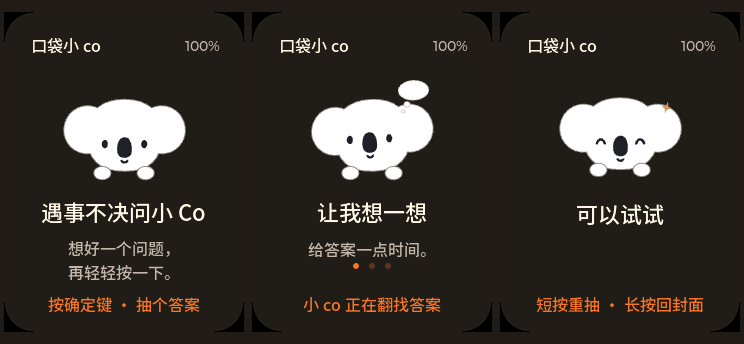

[English](README.md) · **简体中文**

# 口袋小 Co

给 FoloToy AI Passport 的离线答案之书。心里想着问题，按下确定键，
小 Co 就会从 110 条中文文案中为你抽出一个答案。



## 直接安装

从[版本页面](https://github.com/oana011103-byte/pocket-co/releases/tag/pocket-co-v1.0.3)
下载 `pocket-co-v1.0.3-share.zip` 并解压。
用电脑 Chrome 或 Edge 打开[官方刷机工具](https://ai-passport.folotoy.cn/tools/web-flasher/)，
选择安装本地固件，再选择 `pocket-co-v1.0.3-full.bin`。
设备开机后用支持数据传输的 USB 线连接电脑，等安装完成并重启后再拔线。

仅适用于 ESP32-C3、8 MB Flash 的 FoloToy AI Passport。
完整合并镜像写入地址为 `0x0`，会替换现有玩法，并可能重置原有设置。
不需要整片擦除。

## 操作

- 短按确定键：抽取答案，再按可重新抽取
- 长按确定键约半秒：返回封面，思考期间也可取消
- 60 秒无操作调暗背光，第一次短按唤亮
- 右上角百分数为电量，`--` 表示暂不可用

小 Co 使用 Cola 原版的待机、思考和完成动画。
110 条答案全部保存在设备中，不使用 Wi-Fi、蓝牙、声音或账号，
不收集问题，也不保存抽签历史。

## 编译和修改

需要 ESP-IDF 5.5.3、ESP32-C3 工具链、Python 和电脑端 C 编译器。
激活 ESP-IDF，克隆本仓库默认的 `codex/pocket-co` 分支后执行：

```bash
./tools/validate.sh
```

此命令执行仓库检查、电脑测试和隔离固件构建。
可刷入的完整固件位于 `build/FoloToy-AI-Passport-full.bin`；
匹配的 ELF/MAP 和组件镜像保存在 `build/firmware/<sha256>/`。

普通编译可直接使用已提交的字体和动画帧表。
修改答案时，同时更新 `main/pocket-co-content.c` 和确认文案表
`assets/text/pocket-co-answers.txt`，再重新生成字体和图像：

```bash
python3 -m venv .local-tools/assets-venv
.local-tools/assets-venv/bin/python -m pip install -r tools/requirements-pocket-co.txt
npm install --prefix .local-tools/font-converter lv_font_conv@1.5.3
.local-tools/assets-venv/bin/python tools/generate-pocket-co-assets.py \
  --converter .local-tools/font-converter/node_modules/lv_font_conv/lv_font_conv.js
./tools/validate.sh
```

改变答案数量时同步调整数量测试；新增文字要在屏幕上确认，编译成功不代表排版正确。
更多说明见[应用指南](docs/apps/pocket-co.zh_CN.md)、
[素材来源](assets/README.zh_CN.md)和
[ESP-IDF 环境指南](docs/development/engineering/environment-setup.zh_CN.md)。

## 验证及版本标识

1.0.3 已通过编译和电脑测试。2026 年 11 月批量刷入的 19 台全部通过写入校验；
18 台启动日志检查通过，另一台因观察期间拔线，由使用者确认正常。
接收者仍需确认实机屏幕、按键、电量及待机表现。
本仓库不公开设备身份或原始日志。

版本附件保留此前实际刷入的原固件，SHA-256 为：

```text
db717af8f0c53f4416607ad82853c8d3a5d582ebcd8a9a271f339901c6c6d8df
```

发布准备只增加说明、授权和可移植的生成器元数据，不改变应用行为。
工具链会嵌入构建信息，因此不承诺重新编译的文件逐字节相同。

## 授权与致谢

基于 [FoloToy/ai-passport](https://github.com/folotoy/ai-passport)。
本项目编写的应用代码及答案文案使用 MIT 许可证，须保留
[许可证](LICENSE)和原有第三方声明；第三方组件保留各自许可证。
Noto Sans SC 字体及生成子集遵循 [SIL OFL](assets/fonts/noto-ofl.txt)。

**Cola 品牌素材不归入代码的 MIT 许可证。**
原版角色、动画、生成帧和预览允许随本项目公开分发，范围见
[项目随附分发许可](assets/images/composer-co/LICENSE.txt)。
品牌所有权及商标权由相应权利人保留；脱离本项目的其他素材使用需要另行授权。
因此，本仓库提供开源代码及单独授权的品牌美术素材。
